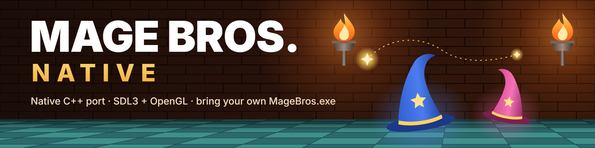

# Mage Bros. Native

An unofficial native port of **Mage Bros.**, the 3D platformer by Saito Games (2003–2009), for
modern Windows. It plays exactly like the original, with optional extras: widescreen, any
resolution and refresh rate, smooth motion, key rebinding and cheats.

**Version 0.4.46.** The whole game is in: all 4 worlds and 40 levels, every enemy and boss, one
or two players, the shop, saving and the ending. What changed in each version:
[CHANGELOG.md](CHANGELOG.md).

> **You need your own copy of the original game.** This project contains none of the game's
> files: everything is read from your `MageBros.exe` and its music files when you play.

## What Native adds

The game itself is the original's: the same levels, enemies, physics, timing and even its quirks.
Around it, Native adds:

- **Runs natively on Windows 10 and 11** with OpenGL instead of the original's DirectX 7: no
  compatibility settings or wrappers needed.
- **Any resolution and screen mode:** a resizable window, borderless or exclusive fullscreen, any
  monitor, instead of the original's fixed 640 × 480. The window opens where you left it.
- **Widescreen** (16:9, 21:9 and wider): see more of each level at the sides, with nothing
  popping in at the edges and the sound panned to match. On the widest screens (21:9, 32:9)
  every enemy in view moves, even at the far edges. The HUD can move to the screen's edges.
- **High refresh rates:** Smooth motion draws the game between its steps for smooth movement at
  144 Hz and beyond, and VSync, adaptive VSync and a frame limit are built in. The game's speed
  and timing never change with the frame rate.
- **Sharper graphics, all optional:** antialiasing, texture filtering, higher render resolution,
  smoother textures and a brightness setting; and new effects, all off by default: ambient
  occlusion (soft shading in corners and under objects), real shadows, light from the flames and
  shots, and a glow round them (bloom).
- **An in-game options menu** (F10) for every setting, with changes applied at once. It shows the
  game's version at the top right.
- **Statistics Overlay** (F9): a see-through panel with the frame rate, the game's timing (with
  graphs), the display settings in effect, your graphics card, the graphics effects in use
  and what each costs it. Off, Compact or Full; stays as you left it.
- **Menu font:** the Classic pixel font, or a font of your own, sharp at any resolution
  ([how](#your-own-menu-font)).
- **Full controls:** rebind every key for both players, and use modern gamepads.
- **Replacement music:** play MP3 or FLAC versions of the six tracks instead of MIDI, or the MIDI
  through a SoundFont of your choice ([how](#your-own-music)).
- **Cheats:** twelve of them, from Unlock all levels to Moon jump, all off by default.
- **Saves you can back up:** your progress is kept in a plain file under `%APPDATA%`.
- **A few fixes:** small slips of the original, such as overlapping messages in two-player games,
  are fixed; each one is listed in [docs/REVERSE_ENGINEERING.md](docs/REVERSE_ENGINEERING.md).

## Getting started

1. Get **Mage Bros. 2.0**, the freeware version, from [saitogames.com](http://www.saitogames.com/).
2. Download the latest `MageBrosNative-<version>-windows-x64.zip` from
   [Releases](https://github.com/Exo-MDR-CD2000/MageBrosNative/releases).
3. Unzip it and put `MageBrosNative.exe` in the same folder as `MageBros.exe` and its
   `Music01.mid` to `Music06.mid` files.
4. Run `MageBrosNative.exe`.

**`MageBrosNative.exe` is the only file you need to play.** The rest of the zip is optional:

| In the zip | What it is |
|---|---|
| `MageBrosAssets.exe` | A tool that lists, checks or exports the resources in your `MageBros.exe` |
| `mbn_tests.exe`, `mbn_collision_tests.exe` | The project's automated tests |
| `README.md`, `docs` | This guide, and documents for developers |
| `LICENSE`, `THIRD_PARTY_NOTICES.md`, `licenses` | The licences of the port and of the libraries built into it |

You can leave these in the zip. If you pass the game on to someone else, include the licence
files with it.

You need Windows 10 or 11 (64-bit). The game checks that `MageBros.exe` is the 2.0 freeware build
(SHA-256 `ac191080af002b8ad0615e432faa92a2a47ce76a9aaa667bacf628836c098c49`); other builds are
refused unless you start it with `--allow-unverified`. If the game is somewhere else, start it
with `--game "C:\path\to\MageBros.exe"` or set `path` in the settings file.

## Controls

| | Player 1 | Player 2 |
|---|---|---|
| Move | Arrow keys | W A S D |
| Jump | Right Shift or `]` | Left Shift or `2` |
| Fire | Right Ctrl or `[` | Left Ctrl or `1` |
| Gamepad | first gamepad | second gamepad |

In a one-player game, Left Shift and Left Ctrl also jump and fire. Every key can be changed in
Options > Controls.

| Key | Action |
|---|---|
| P | Pause |
| F9 | Statistics Overlay: off, compact, full |
| F10 or gamepad Start | Options menu |
| Escape | Give up the level (you lose some gold, as in the original) |
| Alt+Enter or F11 | Switch between window and fullscreen |
| F12 | Screenshot (saved next to the program) |

**How to play:** light every torch in a level by jump-firing over its post, then stand on the goal
to warp to the next level. Shots cost magic, which refills over time. Defeated enemies drop coins;
spend them in the shops (levels 3, 6 and 9 of worlds 1 to 3, and 4-2, 4-5 and 4-8). World 4 opens
once worlds 1 to 3 are cleared.

## Options

Press F10 (or Start) to open the options menu. With every option at its default the game looks
and plays like the original, apart from smoother edges and distant textures (Antialiasing and
Texture filtering, both on by default; turn them off for the original's exact picture).

- **Video:** window, borderless or exclusive fullscreen; resolution and refresh rate; VSync; a
  frame limit, including your monitor's refresh rate and its half, third and quarter, which keep
  movement even; Low latency; **Smooth motion** (off by default), which draws the game between its 100 steps a
  second so it moves smoothly on high refresh rate monitors, without changing the game's speed;
  **Aspect** (4:3, Stretch or Widescreen, which shows more of each level at the sides); HUD
  position and size; and **Field of view**, which is **experimental: we recommend leaving it at
  100%**, the view the original's levels were made for.
- **Graphics:** antialiasing, texture filtering, render scale (up to 200%), smoother textures,
  ambient occlusion, dynamic shadows and dynamic lights (each with its strength), the ambient
  light with dynamic lights on, bloom, and brightness. The new effects are all off by default:
  with them off the game looks as before.
- **Audio:** volume levels, where the music comes from, and the MIDI synth. See
  [Your own music](#your-own-music).
- **Menu font** (on the Video page): the font of the menus and the Statistics Overlay. See below.
- **Controls:** rebind both players' keys and the gamepad buttons.

### Your own music

The game plays its six original MIDI tracks. You can replace any of them with MP3 or FLAC files of
your own, for example a recording or a remix.

1. Make a folder called `music` next to `MageBros.exe`.
2. Put your files in it, named after the track they replace: `Music01.mp3` (or `Music01.flac`)
   replaces `Music01.mid`, and so on up to `Music06`. You can replace one track or all six.
3. Start the game. Options (F10) > Audio > **Music source** must be **Auto** (the default).

| Track | Plays on |
|---|---|
| Music01 | The title, save slots, level select and the ending |
| Music02 to Music05 | The levels of worlds 1 to 4 |
| Music06 | Boss levels |

A track without a file of its own plays its MIDI as usual. If both an MP3 and a FLAC are there,
the FLAC is used. Your music plays, loops, stops and pauses just like the original's. To make a
track loop seamlessly from a point other than its start, give the file `LOOPSTART` and
`LOOPLENGTH` (or `LOOPEND`) tags, in samples, as many game-music files already have; without them
it loops from the end back to the start. To use other file names, set `music_1` to `music_6` in
the settings file. To hear the original music again, set Music source to **MIDI only**.

**Better-sounding MIDI instead:** a General MIDI SoundFont (`.sf2`) changes the instruments the
MIDI music is played with.

1. Put the `.sf2` file next to `MageBros.exe`, or keep them tidy in a folder called `soundfonts`
   next to it.
2. In the game, open Options (F10) > Audio > **Music synth** and press Left or Right to choose it.
   The music switches at once and the choice is remembered.

A file called `soundfont.sf2` or `magebros.sf2` in either place is used automatically. **Windows synth** plays the music as the original did, and **Automatic** goes back to the
default.

### Your own menu font

The menus, the Statistics Overlay and the CHEATS mark use the game's Classic pixel font. You can
use any font you like instead; it is drawn sharp at your screen's resolution.

1. Make a folder called `fonts` next to `MageBros.exe`.
2. Put one or more font files in it (`.ttf` or `.otf`).
3. In the game, open Options (F10) > Video > **Menu font** and press Left or Right to go through
   your fonts. The change shows at once and is remembered.

To go back, choose **Classic**. Fixed-width (monospace) fonts look best, since every letter sits
in the same space; with other fonts, narrow letters like "i" stand a little apart. If a font
shows "(not found)", its file was moved or can't be read, and Classic is used meanwhile. No fonts
come with the game, so check that you're allowed to use the ones you add.

### Cheats

Options > Cheats. All are off by default. While any is on, **CHEATS** shows in the bottom-left
corner.

| Cheat | What it does |
|---|---|
| Unlock all levels | Every level can be picked on level select (set it from the title screen; your saved progress is not changed) |
| Infinite lives | Hits never take your last heart |
| Invincible | Enemies, bullets and flames can't hurt or push you |
| Infinite magic | Firing costs no magic |
| No falling deaths | Falling into a pit or the water puts you back where you last stood |
| Max magic level | Every level starts at magic level 7 |
| Choose your wand | Every level starts with the wand you pick |
| Max gold | Every level starts with 9999 gold |
| Moon jump | Jump 150% or 200% as high |
| Run speed | Walk 125%, 150% or 200% as fast |
| One-hit kills | Enemies and bosses fall to one shot (turtles and ghosts still can't be shot) |
| Rapid fire | Hold fire to keep shooting |

A fall ends a level whatever your hearts, so only No falling deaths protects you from falls. Your
progress is saved as usual with cheats on, and what Max magic level, Choose your wand and Max gold
give you stays in your save.

## Settings and saves

- **Settings:** `magebros_native.ini` next to the program, with a comment for every option. Delete
  it to restore the defaults. A log, `magebros_native.log`, is written next to it.
- **Saves:** `%APPDATA%\MageBrosNative\saves\original\progress.ini`, or the folder set by
  `save_path` in the settings file. There are 8 save slots for one-player games and 8 for
  two-player games, as in the original. Saves from the original game are not carried over.

## For developers

The repository holds everything needed to build the port, but none of the game's files: to run
it, or to run the tests that need the game, you still need your own `MageBros.exe`.

- **Building:** any C++17 compiler and CMake 3.20 or newer. On Windows, double-click
  `make_release.bat` (needs Visual Studio 2022 or newer with "Desktop development with C++"); it
  builds, runs the tests and writes the release zip to `build\`. Step by step, including how a
  release is published: [docs/RELEASING.md](docs/RELEASING.md).
- **Other platforms:** the tools and tests build on Linux and macOS (`-DMBN_BUILD_GAME=OFF`), and
  the Windows game cross-compiles with MinGW-w64
  (`-DCMAKE_TOOLCHAIN_FILE=cmake/mingw-w64-x86_64.cmake`).
- **What gets built:**

  | Program | What it does | Needs the game | In the zip |
  |---|---|---|---|
  | `MageBrosNative.exe` | The game | Yes | Yes |
  | `MageBrosAssets.exe` | Lists (`--inventory`), checks (`--selftest`) or exports (`--export FOLDER`) the resources in your `MageBros.exe` | Yes | Yes |
  | `mbn_tests.exe` | Tests the file-format readers on small built-in samples | No | Yes |
  | `mbn_collision_tests.exe` | Tests that the ColDet collision library answers the game's kinds of query | No | Yes |
  | `mbn_map_tests.exe` | Builds all 40 levels' geometry from your copy and checks it | Yes | No |
  | `mbn_hero_tests.exe` | Runs player 1's movement on all 40 levels: landing on each start floor, the original's jump height, and long random play that must never leave the hero inside a wall | Yes | No |

  `ctest --test-dir build` runs the tests (add `-C Release` for a Visual Studio build); the last
  two only when CMake was configured with
  `-DMBN_GAME_EXE=<path to MageBros.exe>` (or run them with `--game <path>`). Each prints
  "passed" or what failed, and exits with 1 on a failure. The two tests in the zip only show
  that the build works on your machine; players never need them. Files exported by
  `MageBrosAssets.exe` are Saito Games' work: don't share them.
- **Test keys** (games started with them aren't saved): N / B change level, F2 switches between
  one and two players, F3 jumps to the ending, Tab opens the level and model viewers.
- **More:** [docs/ROADMAP.md](docs/ROADMAP.md) (status and plans),
  [docs/REVERSE_ENGINEERING.md](docs/REVERSE_ENGINEERING.md) (how the original works, and its bugs
  and quirks), [docs/SMOOTH_MOTION.md](docs/SMOOTH_MOTION.md),
  [docs/GRAPHICS_ENHANCEMENTS.md](docs/GRAPHICS_ENHANCEMENTS.md) (how the graphics effects work),
  and [CLAUDE.md](CLAUDE.md) (the
  contributor handoff: project rules, source layout, workflow).

The port keeps the original's game logic: the code in `src/game` is reconstructed from the
original program, one file per original module, and collision uses the original's own collision
library, [ColDet](https://sourceforge.net/projects/coldet/), built from its published source. The
engine code (`src/gfx`, `src/audio`, `src/input`, `src/ui`, `src/framework`) comes from
[Hopmon Native](https://github.com/Exo-MDR-CD2000/HopmonNative), by the same author, since both
games run on the same Saito Games engine.

## Legal

Mage Bros., its name, artwork, levels, sounds and music are © 2003–2009 Saito Games; the MIDI
music is © Yamaha Corporation. This project isn't affiliated with or endorsed by Saito Games and
distributes none of the game's files.

The port's own code is MIT-licensed. The reconstructed game logic in `src/game` isn't covered by
the MIT license. ColDet is LGPL-2.0-or-later (in `third_party/coldet` with its license), built as a
separate library that anyone can rebuild with a modified ColDet. See [LICENSE](LICENSE) and
[THIRD_PARTY_NOTICES.md](THIRD_PARTY_NOTICES.md).
